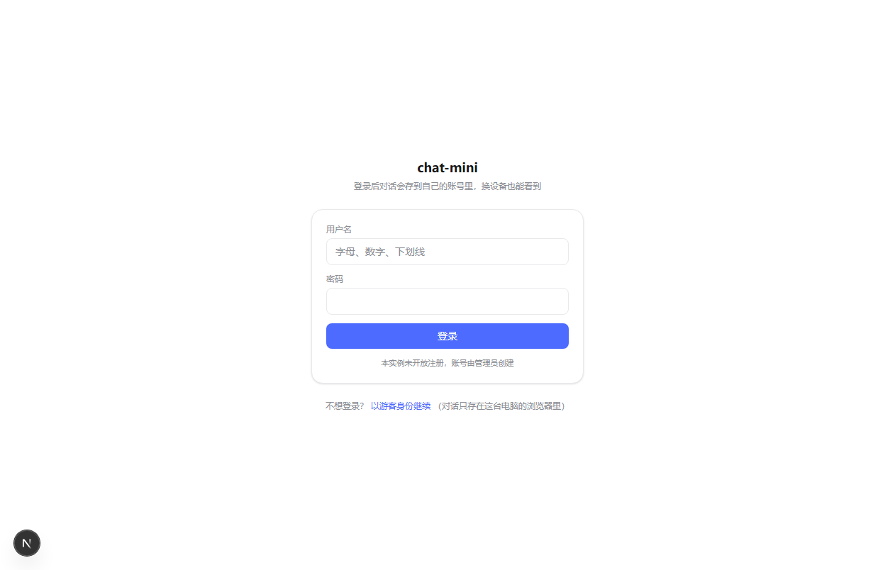
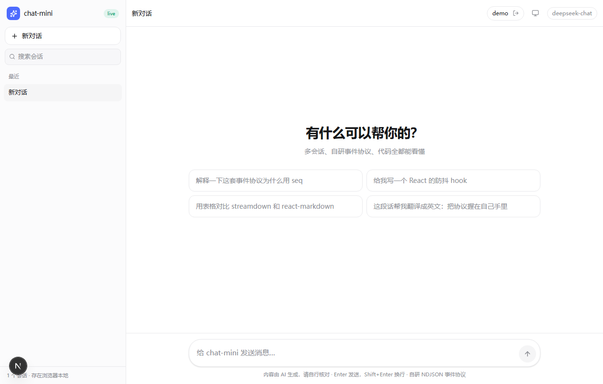
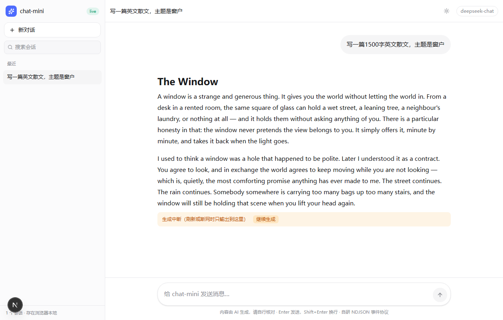

# chat-mini

一个最小 LLM 聊天站：**Next 16 + Tailwind v4 + streamdown + 自研 NDJSON 事件协议**。
没有 zustand，没有 tanstack-query，没有 AI SDK——所有链路都在你自己的代码里。

> 正在把状态层从浏览器搬到 MySQL + 加登录。设计、决策记录、各阶段验收标准见 **[DESIGN.md](DESIGN.md)**。

核心链路 6 个文件、约 500 行（含注释，`cloc` 口径下更少）：

| 部分 | 行数 |
| --- | --- |
| `api/chat/route.ts` + `protocol.ts` + `providers/*` | 265 |
| `use-chat-stream.ts`（前端状态机） | 153 |
| `components/chat.tsx`（界面） | 233 |
| `globals.css`（设计令牌） | 129 |

## 跑起来

```bash
pnpm install
pnpm dev          # http://localhost:3000
```


不配 key 直接就能用：默认走 `src/lib/providers/fake.ts` 的**假数据流**，用来验证协议、渲染和交互。
要接真模型：

```bash
cp .env.example .env.local
# 官方：DEEPSEEK_API_KEY=sk-xxx
# 中转站/自建网关：再加一行 DEEPSEEK_BASE_URL=https://xxx.com（或 https://xxx.com/v1）
```

页面右上角的 `mock` / `live` 徽标会告诉你当前走的是哪条路。
key 无效时不会静默失败，错误会以一条 `error` 事件推到界面上（并提示去检查 `DEEPSEEK_BASE_URL`）。

## 登录与账号（MySQL）

数据库表结构在 `scripts/schema.sql`，设计见 [DESIGN.md](DESIGN.md)。首次部署三步：

```bash
# 1. 建表（应用账号没有 DDL 权限，必须用 root 跑一次）
mysql -u root -p --default-character-set=utf8mb4 chat_mini < scripts/schema.sql

# 2. 建库和低权限应用账号（只需要跑一次，示例）
#    CREATE DATABASE chat_mini CHARACTER SET utf8mb4 COLLATE utf8mb4_0900_ai_ci;
#    CREATE USER 'chat_app'@'localhost' IDENTIFIED BY '...';
#    GRANT SELECT, INSERT, UPDATE, DELETE ON chat_mini.* TO 'chat_app'@'localhost';

# 3. 建自己的账号（注册接口默认关闭，账号只能这样加）
node scripts/create-user.mjs 你的用户名
#    改密码：node scripts/create-user.mjs 你的用户名 --reset
```

自检：

```bash
curl http://localhost:3000/api/health     # 数据库连上了吗、表建齐了吗
node scripts/e2e-auth.mjs                 # 16 项认证检查（登录/登出/限流/CSRF/越权报文）
node scripts/e2e-sessions-api.mjs         # 23 项会话接口检查（隔离/分页/搜索/软删）
node scripts/e2e-chat-server.mjs          # 21 项服务端生成检查（落库/取消/重启降级）
node scripts/e2e-logged-in.mjs            # 19 项浏览器实测（需先起无头 Chrome，见脚本头）
```

生成的两条路径（同一个 `POST /api/chat`）：

```
登录用户  { sessionId, kind, content|messageId }
          kind=send|regenerate|edit|continue
          服务端从库里取历史 → 写消息 → 流式每秒落盘 → 结束定稿
游客      { messages: [...] }
          只生成，不写库（数据在浏览器本地）
```

登录后数据在服务端：

- 会话列表、消息、标题都在 MySQL 里，换浏览器/清缓存都还在
- `localStorage` 只剩一个"上次看的是哪个会话"的标记
- 刷新时如果那条回答正在生成，会带着水位自动续上；进程崩过的话显示"生成中断 + 继续生成"

进程重启时 `src/instrumentation.ts` 会把上一轮残留的 `status='running'` 全部收拾掉：
消息标成 `interrupted`（保留已输出的内容）——因为生成跑在内存里，进程一没，那条流就真的没了，
库里存的只是它写过的部分。

会话与消息接口（都要登录，全部按 `user_id` 隔离，越权一律 404）：

```
GET    /api/sessions?limit=&cursor=        列表（游标分页，按 updatedAt 倒序）
POST   /api/sessions                       新建
GET    /api/sessions/:id                   单个
PATCH  /api/sessions/:id                   改名
DELETE /api/sessions/:id                   软删除（数据留在库里，deleted_at 有值）
GET    /api/sessions/:id/messages          消息（?afterSeq= 取增量）
GET    /api/sessions/search?q=             标题 LIKE + 正文 ngram 全文索引
```

**游客模式**：不登录也能正常聊天，对话只存在这台电脑的浏览器里；登录后看到的是账号里的数据。
两套数据**不做合并**——这是刻意的取舍，省掉一堆冲突处理。

| 登录页 | 登录后的顶栏 |
| --- | --- |
|  |  |

**密码与会话怎么存**（细节见 DESIGN.md §6）：

- 密码用 Node 内置 `scrypt`（N=65536，每用户独立随机盐，异步版避免堵事件循环），库里是 `scrypt$65536$8$1$salt$hash`
- cookie 里是 32 字节随机令牌，库里只存 `sha256(令牌)`——库泄露也不能直接拿去做 cookie
- cookie 属性 `HttpOnly` + `SameSite=Lax`，本地不带 `Secure`（否则 http://localhost 存不下）
- 同一用户名+IP 连错 5 次锁 5 分钟

## 现在已经能做的

- 流式对话（真模型 / 假数据流一键切换）
- **登录 / 游客双模式**：登录后对话存 MySQL、多设备可见；不登录也能用（数据只在本地浏览器）
- 停止生成（AbortController 一路断到 provider）
- **多会话**：侧栏列表、切换、删除、标题自动取首条消息；`localStorage` 持久化，刷新不丢
- **断线续传**：生成跑在服务端，刷新/断网/切标签页回来能接着续（按 `seq` 水位补发，不重头不重复）
- **会话管理**：搜索（按标题，实时过滤）、重命名（双击标题或点铅笔，Enter 保存 / Esc 取消，改名不改变排序）
- **消息动作**：复制、重新生成、编辑重发（改掉用户消息后从那里重新流，之后的回答会被丢弃）
- 思维链单独折叠（配 `DEEPSEEK_MODEL=deepseek-reasoner` 就能看到真的）
- Markdown 全支持：表格 / 代码高亮 / 引用 / 列表，代码块自带复制下载
- **主题三态**：浅色 / 深色 / 跟随系统，记住了刷新不跳；首屏由内联脚本先定 class，不会闪白
- token 用量显示（真实 usage，不是估算）


搜索与重命名：

| 搜索 | 重命名 |
| --- | --- |
|  |  |

深色主题（含 shiki 深色代码高亮）：


生成被中断时会明确标注，并给「继续生成」接着写（输出仍落在同一条气泡里）：



## 文件地图

| 文件 | 干什么 |
| --- | --- |
| `src/lib/db.ts` | MySQL 连接层：连接池（挂 globalThis 防热重载泄漏）、预处理语句、事务、错误翻译成人话 |
| `src/lib/password.ts` | 密码哈希：Node 内置 scrypt（异步）+ `timingSafeEqual` |
| `src/lib/auth.ts` | 登录会话：建令牌、cookie 读写、`getCurrentUser`、过期清理 |
| `src/lib/users.ts` | 账号的数据访问：校验、建号、校验凭据（不存在时也走假验证防时序探测） |
| `src/lib/http.ts` | 路由小工具：JSON 出入口、Origin 校验、取 IP/UA |
| `src/lib/rate-limit.ts` | 登录爆破防护（5 次锁 5 分钟，进程内存） |
| `src/app/api/health/route.ts` | 环境自检：数据库连没连上、表建齐没有 |
| `src/app/api/auth/*` | `register`（默认关）/ `login` / `logout` / `me` |
| `src/app/login/page.tsx` | 登录页（已登录自动跳回首页） |
| `src/components/login-form.tsx` | 登录/注册表单 |
| `src/components/account-menu.tsx` | 顶栏账号区：未登录显示"登录"，已登录显示名字 + 登出 |
| `src/app/api/chat/route.ts` | 建 run：立刻返回 `runId`，生成在服务端后台继续跑 |
| `src/app/api/chat/stream/route.ts` | 订阅 run：`?runId=&afterSeq=` 先回放再实时推 |
| `src/app/api/chat/cancel/route.ts` | 停掉服务端生成（否则"停止"只是不看了，token 还在烧） |
| `src/lib/runs.ts` | 进程内 run 表：事件缓冲、订阅广播、按 seq 压缩成快照、TTL 清理 |
| `src/lib/chat-repo.ts` | 会话/消息的数据访问：所有查询强制带 `user_id`、seq 事务内分配、软删除、ngram 搜索 |
| `src/lib/chat-service.ts` | 登录用户的生成：取历史、四种操作（send/regenerate/edit/continue）、每秒落盘、定稿 |
| `src/lib/api-guard.ts` | `requireUser()`：没登录就 401，路由里一眼看得见 |
| `src/lib/startup.ts` | 启动清理：残留的 `running` 标成 interrupted、过期登录会话清掉 |
| `src/instrumentation.ts` | Next 启动钩子，把上面的清理挂到进程启动 |
| `src/lib/protocol.ts` | 事件类型 + 编解码 + 上行报文清洗 |
| `src/lib/providers/fake.ts` | 假数据流（带 think_delta、表格、代码块） |
| `src/lib/providers/deepseek.ts` | 真数据流：把 DeepSeek 的 SSE 翻译成我们自己的事件（支持 `DEEPSEEK_BASE_URL`） |
| `src/lib/sessions.ts` | 会话存储层：读写 localStorage、标题派生、旧版数据迁移、`pending` 状态归一 |
| `src/lib/use-chat.ts` | 会话 + 生成的唯一状态源。一个引擎两个后端：游客走 localStorage，登录走服务端 API；`send/regenerate/editAndResend/continueGeneration` 共用一条续传链路 |`startRun` |
| `src/components/sidebar.tsx` | 会话列表：新建 / 切换 / 删除 / 搜索 / 重命名 / 自动标题 |
| `src/lib/theme.ts` | 主题三态：读写偏好、解析 system、首屏内联脚本字符串 |
| `src/lib/use-theme.ts` | 主题状态 hook：挂载读偏好、监听系统配色、只改 `<html class>` |
| `src/components/theme-menu.tsx` | 右上角主题菜单（浅色 / 深色 / 跟随系统） |
| `src/components/chat.tsx` | 界面：空态、消息流、动作条、编辑重发、输入框、移动端抽屉 |
| `src/app/globals.css` | 设计令牌（shadcn 语义命名）+ Tailwind v4 配置 |
| `src/app/preview/page.tsx` | 渲染自检页：固定 markdown，用来看 streamdown 样式对不对 |

## 协议（一行一个 JSON）

```
{"seq":1,"type":"think_delta","delta":"用户发来的是"}
{"seq":2,"type":"delta","delta":"### 现在是假数据流"}
{"seq":320,"type":"usage","prompt_tokens":8,"completion_tokens":401}
{"seq":321,"type":"completed","finish_reason":"stop"}
```

- `seq` 单调递增，前端用 `if (event.seq <= lastSeq) continue` 做幂等，天然抗重复投递——断线续传就是靠它。
- 还有一个覆盖式事件 `{"type":"sync","seq":602,"content":"…","thinking":""}`：服务端把旧事件压缩后，用它把正文一次性对齐。
- 想加新事件（`rag_search` / `file_proc` / `tool_call` …）只改 `protocol.ts` 的联合类型 + 两处 switch，别的地方不用动。

## 生成为什么不是"一条普通请求"

如果生成寄生在 `fetch` 的那条连接上，用户一刷新，连接断 → 服务端 `ReadableStream` 被 cancel → 上游 abort → **生成直接死掉**，界面上只剩半截（内容其实还在，只是没人生成了）。

所以这里把生成拆成"任务 + 订阅"：

```
POST /api/chat                    建 run，立刻返回 { runId }，生成在服务端继续跑
GET  /api/chat/stream?runId&afterSeq   订阅：回放 afterSeq 之后的事件，再实时推
POST /api/chat/cancel             真正停掉服务端生成
```

客户端把 `runId + appliedSeq` 和正文写在**同一条消息里**（同一次 `saveStore` 落盘，所以水位不会和正文脱节）。刷新后带着 `afterSeq` 重连，服务端只补发没消费过的事件 —— 视觉上是同一段文字**继续往下长**，不重头、不重复。

代价（都在 `src/lib/runs.ts` 顶部注明）：
- run 存在**进程内存**里：单机 `next start` / Docker 可用；Serverless 不好使；多实例要换 Redis
- **dev 热重载会重置 run**，开发时改代码正在跑的那条会丢（生产没这问题）
- 结束的 run 保留 10 分钟（TTL），过期后再刷新就降级为"生成中断 + 继续生成"

## 三个踩过的坑（改配置时别踩回去）

1. **Tailwind v4 不扫描 `node_modules`**，而 streamdown 的默认组件把样式写成类名放在 dist 里。
   所以 `globals.css` 里必须有 `@source "../../node_modules/streamdown/dist";`，否则 markdown 会静默掉一部分样式。
2. **Next 16 dev 会校验静态资源来源**，用 `127.0.0.1` 打开时客户端 chunk 会 403（表现：样式在、高亮和交互不在）。
   `next.config.ts` 里的 `allowedDevOrigins: ["127.0.0.1", "localhost"]` 就是干这个的。
3. **Tailwind v4 的 `dark:` 默认跟媒体查询走**。要做"手动切深色"就必须声明
   `@custom-variant dark (&:where(.dark, .dark *));`，并把深色令牌从 `@media (prefers-color-scheme: dark)`
   挪到 `.dark` 上——否则切了 class 也没人理，streamdown 的 `dark:` 样式同样不会生效。

## 自检脚本

```bash
# 无头 Chrome + CDP，抓页面 console，排查"样式在但交互没反应"这类问题
node scripts/probe-console.mjs http://127.0.0.1:3123/preview 15

# 端到端（多会话）：清历史 → 发送确认流式增长 → 新对话 → 切回 → 刷新验证持久化 → 删除
node scripts/e2e-chat.mjs ./shots

# 端到端（消息动作）：重新生成 / 编辑重发 / 复制（会注入可控剪贴板）
node scripts/e2e-actions.mjs

# 端到端（侧栏）：搜索 / 空结果 / 清空 / 重命名 / Esc 取消 / 刷新保持 / 顺序不变
node scripts/e2e-sidebar.mjs

# 端到端（主题）：首屏不闪白 / 三态切换 / 持久化 / 代码高亮跟随 / 手动压过系统
node scripts/e2e-theme.mjs

# 端到端（断线续传）：中途刷新继续增长 / 不重复 / 停止真生效 / run 过期降级 / 继续生成
node scripts/e2e-resume.mjs

# 服务端探针：run 回放、水位、压缩(sync)、取消、404（不需要浏览器）
node scripts/probe-runs.mjs
```

脚本都可配 `CDP_PORT` / `BASE_URL`，并且都要求先起一个带调试端口的 Chrome：

```bash
chrome --headless=new --remote-debugging-port=9223 --user-data-dir=/tmp/cdp about:blank
```

## 下一步可以加什么

- 会话置顶 / 按标题或内容全文搜索（现在只按标题包含匹配）
- 消息级"从这里分支"（现在是编辑即截断，多分支要另存会话）
- 事件补全：`rag_search` / `file_proc` / `compact_done`（想复刻目标站的"流过程"体验时再加）
- 多标签页同步（现在两个标签页各存各的，后写的覆盖先写的）
