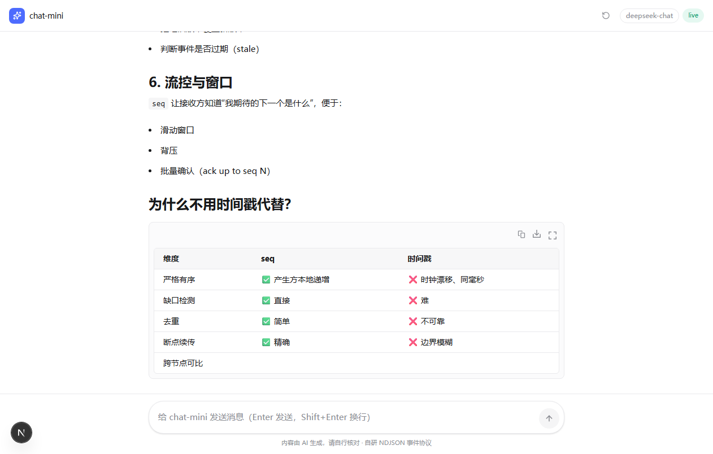
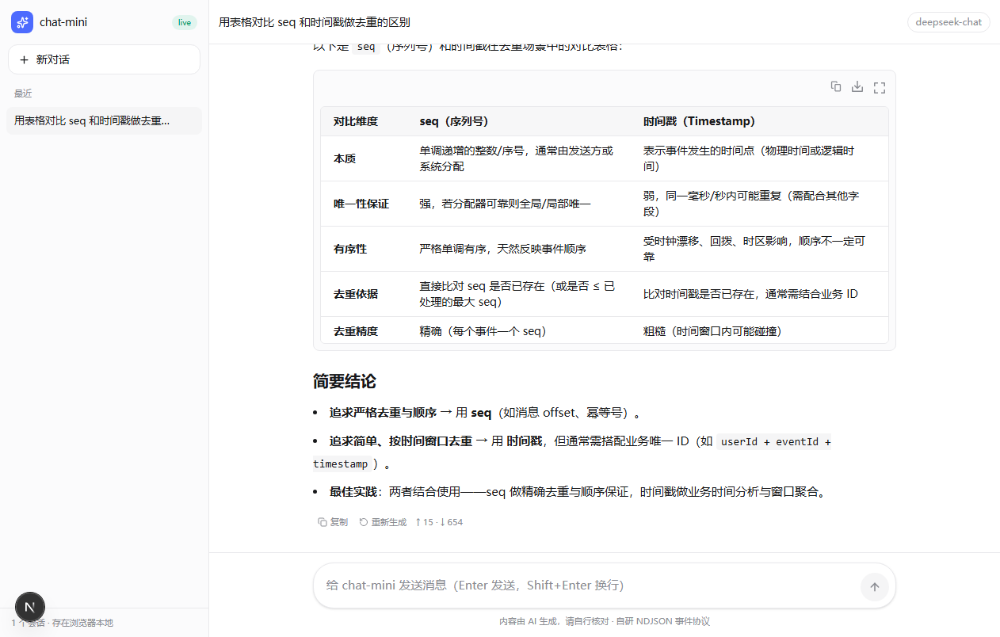
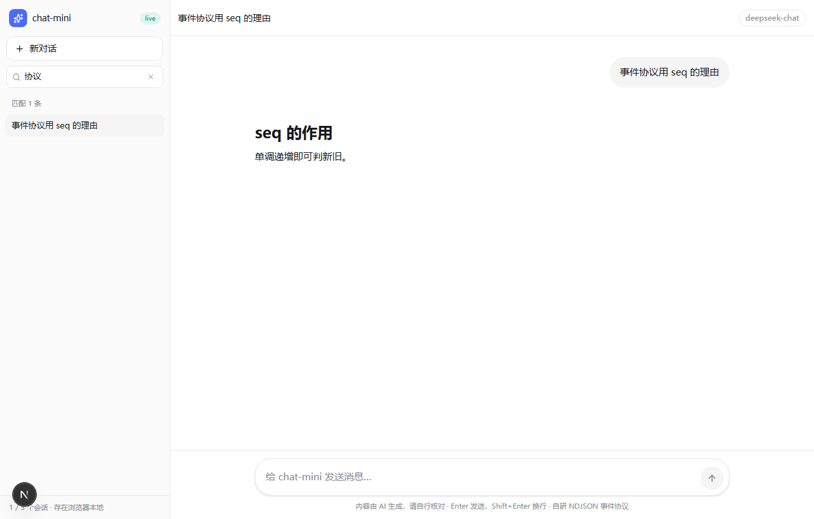
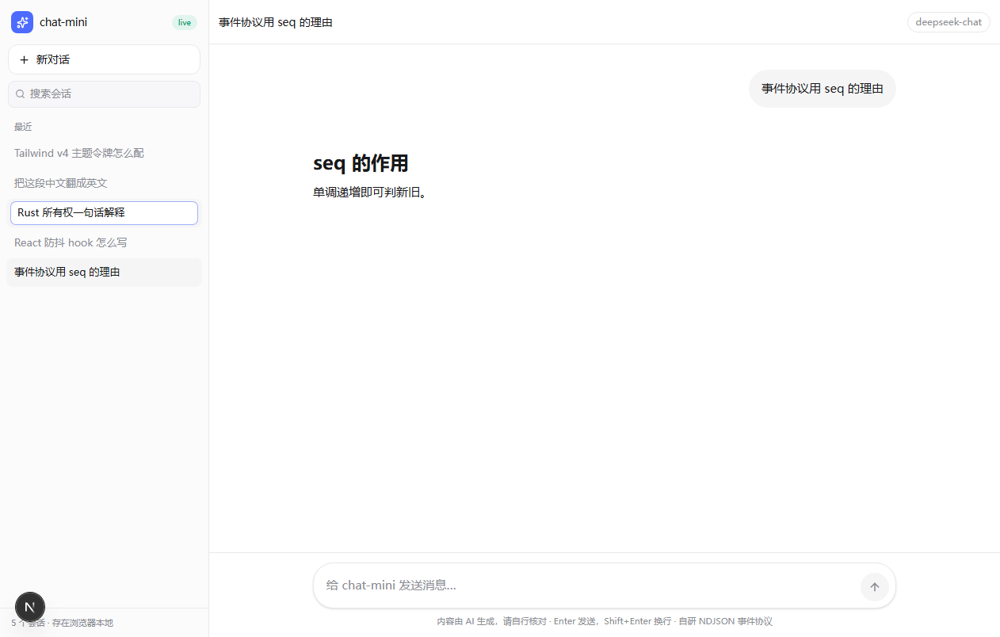
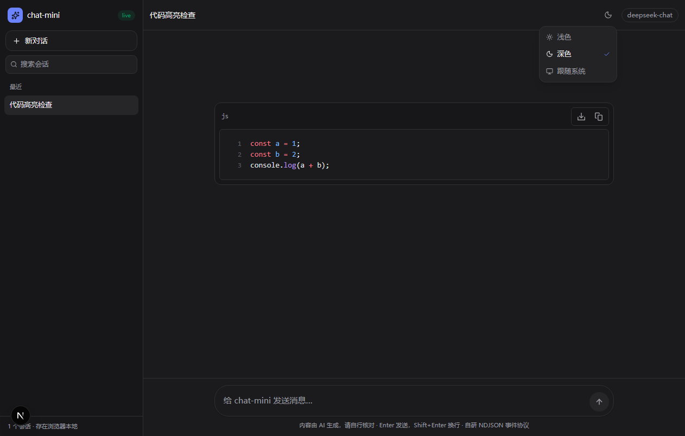

# chat-mini

一个最小 LLM 聊天站：**Next 16 + Tailwind v4 + streamdown + 自研 NDJSON 事件协议**。
没有 zustand，没有 tanstack-query，没有 AI SDK——所有链路都在你自己的代码里。

核心链路 6 个文件、约 500 行（含注释，`cloc` 口径下更少）：

| 部分 | 行数 |
| --- | --- |
| `api/chat/route.ts` + `protocol.ts` + `providers/*` | 265 |
| `use-chat-stream.ts`（前端状态机） | 153 |
| `components/chat.tsx`（界面） | 233 |
| `globals.css`（设计令牌） | 129 |

## 跑起来

```bash
pnpm install
pnpm dev          # http://localhost:3000
```



不配 key 直接就能用：默认走 `src/lib/providers/fake.ts` 的**假数据流**，用来验证协议、渲染和交互。
要接真模型：

```bash
cp .env.example .env.local
# 官方：DEEPSEEK_API_KEY=sk-xxx
# 中转站/自建网关：再加一行 DEEPSEEK_BASE_URL=https://xxx.com（或 https://xxx.com/v1）
```

页面右上角的 `mock` / `live` 徽标会告诉你当前走的是哪条路。
key 无效时不会静默失败，错误会以一条 `error` 事件推到界面上（并提示去检查 `DEEPSEEK_BASE_URL`）。

## 现在已经能做的

- 流式对话（真模型 / 假数据流一键切换）
- 停止生成（AbortController 一路断到 provider）
- **多会话**：侧栏列表、切换、删除、标题自动取首条消息；`localStorage` 持久化，刷新不丢
- **会话管理**：搜索（按标题，实时过滤）、重命名（双击标题或点铅笔，Enter 保存 / Esc 取消，改名不改变排序）
- **消息动作**：复制、重新生成、编辑重发（改掉用户消息后从那里重新流，之后的回答会被丢弃）
- 思维链单独折叠（配 `DEEPSEEK_MODEL=deepseek-reasoner` 就能看到真的）
- Markdown 全支持：表格 / 代码高亮 / 引用 / 列表，代码块自带复制下载
- **主题三态**：浅色 / 深色 / 跟随系统，记住了刷新不跳；首屏由内联脚本先定 class，不会闪白
- token 用量显示（真实 usage，不是估算）



搜索与重命名：

| 搜索 | 重命名 |
| --- | --- |
|  |  |

深色主题（含 shiki 深色代码高亮）：



## 文件地图

| 文件 | 干什么 |
| --- | --- |
| `src/app/api/chat/route.ts` | 唯一后端入口：选 provider、给事件打 seq、按行编码进 ReadableStream |
| `src/lib/protocol.ts` | 事件类型 + 编解码 + 上行报文清洗 |
| `src/lib/providers/fake.ts` | 假数据流（带 think_delta、表格、代码块） |
| `src/lib/providers/deepseek.ts` | 真数据流：把 DeepSeek 的 SSE 翻译成我们自己的事件（支持 `DEEPSEEK_BASE_URL`） |
| `src/lib/sessions.ts` | 会话存储层：读写 localStorage、标题派生、旧版单会话数据迁移 |
| `src/lib/use-chat.ts` | 会话 + 流式的唯一状态源：切会话时 abort，事件回填绑定 sessionId；`regenerate` / `editAndResend` 复用同一个 `streamInto` |
| `src/components/sidebar.tsx` | 会话列表：新建 / 切换 / 删除 / 搜索 / 重命名 / 自动标题 |
| `src/lib/theme.ts` | 主题三态：读写偏好、解析 system、首屏内联脚本字符串 |
| `src/lib/use-theme.ts` | 主题状态 hook：挂载读偏好、监听系统配色、只改 `<html class>` |
| `src/components/theme-menu.tsx` | 右上角主题菜单（浅色 / 深色 / 跟随系统） |
| `src/components/chat.tsx` | 界面：空态、消息流、动作条、编辑重发、输入框、移动端抽屉 |
| `src/app/globals.css` | 设计令牌（shadcn 语义命名）+ Tailwind v4 配置 |
| `src/app/preview/page.tsx` | 渲染自检页：固定 markdown，用来看 streamdown 样式对不对 |

## 协议（一行一个 JSON）

```
{"seq":1,"type":"think_delta","delta":"用户发来的是"}
{"seq":2,"type":"delta","delta":"### 现在是假数据流"}
{"seq":320,"type":"usage","prompt_tokens":8,"completion_tokens":401}
{"seq":321,"type":"completed","finish_reason":"stop"}
```

- `seq` 单调递增，前端用 `if (event.seq <= lastSeq) continue` 做幂等，天然抗重复投递，也是将来做断线补读的钩子。
- 想加新事件（`rag_search` / `file_proc` / `tool_call` …）只改 `protocol.ts` 的联合类型 + 两处 switch，别的地方不用动。

## 两个踩过的坑（改配置时别踩回去）

1. **Tailwind v4 不扫描 `node_modules`**，而 streamdown 的默认组件把样式写成类名放在 dist 里。
   所以 `globals.css` 里必须有 `@source "../../node_modules/streamdown/dist";`，否则 markdown 会静默掉一部分样式。
2. **Next 16 dev 会校验静态资源来源**，用 `127.0.0.1` 打开时客户端 chunk 会 403（表现：样式在、高亮和交互不在）。
   `next.config.ts` 里的 `allowedDevOrigins: ["127.0.0.1", "localhost"]` 就是干这个的。
3. **Tailwind v4 的 `dark:` 默认跟媒体查询走**。要做"手动切深色"就必须声明
   `@custom-variant dark (&:where(.dark, .dark *));`，并把深色令牌从 `@media (prefers-color-scheme: dark)`
   挪到 `.dark` 上——否则切了 class 也没人理，streamdown 的 `dark:` 样式同样不会生效。

## 自检脚本

```bash
# 无头 Chrome + CDP，抓页面 console，排查"样式在但交互没反应"这类问题
node scripts/probe-console.mjs http://127.0.0.1:3123/preview 15

# 端到端（多会话）：清历史 → 发送确认流式增长 → 新对话 → 切回 → 刷新验证持久化 → 删除
node scripts/e2e-chat.mjs ./shots

# 端到端（消息动作）：重新生成 / 编辑重发 / 复制（会注入可控剪贴板）
node scripts/e2e-actions.mjs

# 端到端（侧栏）：搜索 / 空结果 / 清空 / 重命名 / Esc 取消 / 刷新保持 / 顺序不变
node scripts/e2e-sidebar.mjs

# 端到端（主题）：首屏不闪白 / 三态切换 / 持久化 / 代码高亮跟随 / 手动压过系统
node scripts/e2e-theme.mjs
```

脚本都可配 `CDP_PORT` / `BASE_URL`，并且都要求先起一个带调试端口的 Chrome：

```bash
chrome --headless=new --remote-debugging-port=9223 --user-data-dir=/tmp/cdp about:blank
```

## 下一步可以加什么

- 会话置顶 / 按标题或内容全文搜索（现在只按标题包含匹配）
- 消息级"从这里分支"（现在是编辑即截断，多分支要另存会话）
- 事件补全：`rag_search` / `file_proc` / `compact_done`（想复刻目标站的"流过程"体验时再加）
- 多标签页同步（现在两个标签页各存各的，后写的覆盖先写的）
