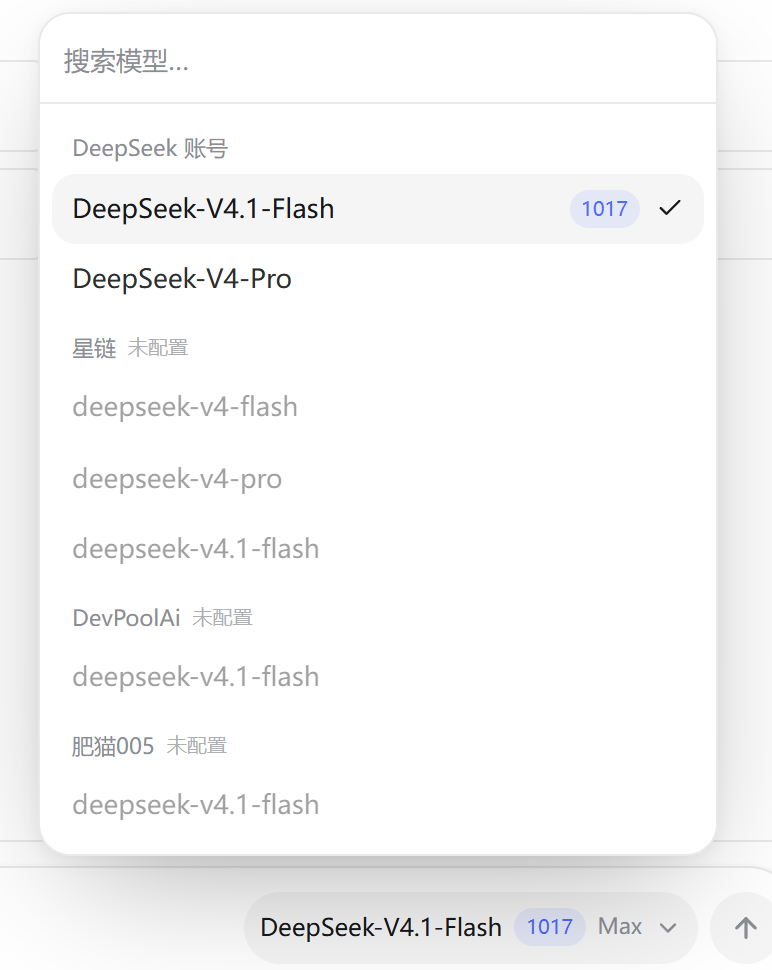

# 模型切换器：截图拆解、同类项目对照，以及 chat-mini 的落地

> 配套实现：`src/components/model-picker.tsx` + `src/lib/models.ts` + `src/lib/use-models.ts`  
> 自检：`node scripts/e2e-model-picker.mjs`（25 项）  
> 截图：`docs/model-picker.png`、`docs/model-picker-dark.png`、`docs/model-picker-mobile.png`



---

## 0. 先说结论

截图里那个东西看起来是个「下拉框」，实际是四层东西叠在一起：

1. **服务端模型目录**：有哪些 provider、每个 provider 下有哪些模型、各自能不能用。
2. **公开 id**：前端只拿 `deepseek:v4.1-flash` 这种 id，不碰 upstream 模型名、base URL、API Key。
3. **选择状态**：这次选择存在哪（全局 / 会话 / 消息 / 助手），以及刷新后怎么恢复。
4. **弹层 UI**：搜索、分组、徽标、选中态、键盘、移动端。

大部分项目把 80% 的精力花在第 4 层，最后被第 1、3 层反噬：
模型名写死在前端、切换后旧会话串模型、加一家 provider 要改五个文件。
所以这件事的正确顺序是 **目录 → 状态 → 请求路由 → UI**，不是反过来。

---

## 1. 把截图拆开

### 1.1 五个部件

| 部件 | 截图里的表现 | 真正要决定的事 |
| --- | --- | --- |
| 触发器 | 输入框右侧：模型名 + 蓝色 `1017` + `Max` + 向上箭头 | 放哪、显示哪些字段、打开时什么状态 |
| 弹层 | 宽度约 330px，圆角 12~16，大而软的阴影，贴在输入框上方 | 向上开还是向下开、多宽、最大高度、移动端怎么办 |
| 搜索 | 顶部一条无边框输入，占位「搜索模型…」 | 搜什么字段、空结果怎么显示、要不要防抖 |
| 分组 | 小号灰字：DeepSeek 账号 / 星链 / DevPoolAi / 肥猫005 | 按 provider、按账号、还是按能力分 |
| 行 | 模型名 + 倍率徽标 + 选中勾；未配置的整行变灰 | 行高、选中态、禁用态、键盘高亮 |

### 1.2 交互状态清单

| 状态 | 预期行为 |
| --- | --- |
| 默认 | 显示上次选择；没有就用服务端默认 |
| 打开 | 搜索框自动聚焦；当前选中项滚进可视区 |
| 搜索命中 | 按「模型名 / id / 徽标 / 分组名」过滤；空分组整组隐藏 |
| 搜索为空 | 明确写「没有匹配的模型」，不要只留一片白 |
| 鼠标悬停 | 行底色变化，但不改变键盘高亮的位置 |
| 键盘 | ↑↓ 移动、Enter 确认、Esc 关闭并把焦点还给触发器 |
| 已选 | 浅灰底 + 右侧勾；勾和徽标不要抢同一个位置 |
| 未配置 | 整行降透明度 + 不可点，分组标题标「未配置」 |
| 移动端 | 弹层不能超出视口；输入框和模型按钮可以折成两行 |

### 1.3 从截图量出来的视觉参数

不是精确值，但足够开写：

- 弹层：`330~340 × 420~520`，圆角 `16px`，1px 边框，阴影 `0 24px 70px -20px rgba(0,0,0,.35)`
- 搜索区：高约 `40px`，底部一条极淡的分隔线
- 分组标题：`11px` 中等字重，灰色，上间距比下间距大
- 行：高 `36~40px`，左右 `10~12px`，圆角 `12px`
- 选中行：`--muted` 底色，字重加一档
- 徽标：`10~11px`，`primary/10` 底，`primary` 字，等宽数字
- 触发器：`12px`，次要文字颜色，箭头 `14px`
- 方向：**向上开、右对齐**。输入框永远在底部，向下开一定被视口裁掉

---

## 2. 其他项目怎么做

> 下面看的是「模式」，不是逐行源码。项目都在快速迭代，具体文件会变，模式不会。
> 参考链接在文末。

### 2.1 七种形态对照

| 项目 | 选择器形态 | 目录怎么组织 | 选择状态放哪 | 值得借鉴 | 别照抄的地方 |
| --- | --- | --- | --- | --- | --- |
| **Vercel AI Chatbot** | Popover + Command（cmdk） | 代码里的 provider/model 配置，带 capabilities | 会话级 | 配置即目录；能力标签（reasoning / vision）参与筛选；服务端按 entitlement 过滤 | cmdk 的默认行样式偏「命令面板」，聊天场景要再压一层 |
| **LobeChat** | 分组 Select（后迁移到 LobeSelect） | provider 分组；provider 配置在设置页 | topic / agent 级，近期 PR 在做 topic-scoped model | 模型被当成「角色的一部分」，不是全局开关；provider 与模型解耦 | 它的模型设置层很厚，小站照搬会过度设计 |
| **Open WebUI** | 聊天输入区的 ModelSelector | 后端 `/api/models` + 连接配置 | **每个对话**保存自己的模型；有 arena 随机模式 | 对话级模型；模型列表服务端给；随机模型是一个很轻的实验功能 | 它的模型来源多（本地/远端/管道），小站不需要这么多分支 |
| **Cherry Studio** | provider → model 两层 | provider 配置 + 模型管理 | 助手 / 话题默认 | 设置页管 provider、聊天页管选择，职责清楚 | 两层导航对 10 条模型是杀鸡用牛刀 |
| **Chatbox** | provider 配置驱动的下拉 | 以自定义 provider 为中心 | 偏客户端全局设置（随版本有差异） | 自定义 OpenAI 兼容 provider 的配置体验 | 它的强项是 provider 配置，不是聊天内的高频切换 |
| **NextChat** | 设置里维护模型列表 + 聊天页下拉 | 平铺 + 自定义模型名 | 全局默认 | 模型列表可配置、可自定义名字 | 平铺列表超过 20 条就难找 |
| **LibreChat** | Model Specs | 「模型 + 提示词 + 参数」打包成预设 | 会话选择 preset | 把模型和它的使用方式一起选，比只选模型更接近真实需求 | 需要额外维护 spec，纯模型切换用不上 |
| **OpenRouter** | 目录页 | 价格、上下文、模态等元数据 | 选择即用 | 元数据驱动的搜索/筛选；详情页解释差异 | 它是「模型市场」，不是聊天内切换器 |

### 2.2 三个反复出现的共识

**共识一：目录在服务端，前端只拿 id + 展示元数据。**

Vercel 的模型配置、Open WebUI 的 `/api/models`、LobeChat 的 provider 配置都是这个路子。
好处不只是安全，还有一条很实际的：换模型名、加中转站、调默认值，不用发前端版本。

**共识二：按 provider 分组，能力只做标签。**

截图里分的是「DeepSeek 账号 / 星链 / DevPoolAi / 肥猫005」——这是**渠道**，不是能力。
能力（推理 / 视觉 / 工具）适合做成行内小标签或筛选器，不适合当一级分组：
用户找模型时先想到「我在哪家充了钱」，再想到「我要不要推理」。

**共识三：搜索必须同时匹配模型名和 provider 名。**

用户可能只记得「星链」，也可能只记得「flash」。
只搜模型名，前者就找不到；只搜 provider，后者就找不到。两个字段拼起来做 includes 是最低要求。

### 2.3 真正的分歧：选择状态放在哪

这是比 UI 重要得多的决定。

| 粒度 | 代表 | 优点 | 代价 |
| --- | --- | --- | --- |
| **全局最后使用** | NextChat 一类 | 实现最省事；换会话不用重新选 | 切到旧会话会「串模型」；用户以为那条对话还在用原来的模型 |
| **每个会话** | Open WebUI；LobeChat 的 topic-scoped | 符合「一个对话一个上下文」的直觉；切回来还是原模型 | 会话表要加字段；新建会话要决定继承谁 |
| **每条消息快照** | 认真做审计的产品 | 重新生成能用「当时那条消息的模型」；历史可解释 | 消息表加字段；UI 要能显示「这条是谁答的」 |
| **每个助手 / Agent** | Cherry Studio、LobeChat 的 agent | 模型是角色配置的一部分 | 需要「助手」这个概念；纯聊天站没有 |

**chat-mini 这次选了「全局最后使用 + 请求级指定」**，理由很直接：

- 现在没有「助手」概念，硬造一层不划算；
- 会话表加 `model` 要动 schema、DTO、PATCH、水合，收益是「切旧会话不串」；
- 先把目录、路由、UI 做对，状态粒度可以后换——换的时候只动 `use-models.ts` 和几个请求点。

这不是终局。真要长期用，建议按「会话级 + 消息快照」升级，步骤见 §4.8。

### 2.4 另一个分歧：配置入口和选择入口要分开

- **配置**（API Key、base URL、有哪些模型）属于设置页，低频、需要解释、可能失败。
- **选择**（这次用哪个）属于输入框，高频、要快、不该弹设置。

截图把它放在输入框旁边，说明它优化的是「同一套账号下频繁换模型」。
如果你只有一家 provider，也可以只在设置页放一个下拉；但一旦有第二家，输入框旁边的入口就会变得必要。

---

## 3. 五条实现路线

| 路线 | 依赖 | 行内徽标/状态 | 键盘与 a11y | 适合 |
| --- | --- | --- | --- | --- |
| A. 原生 `<select>` + `<optgroup>` | 0 | 做不了（只能纯文本） | 浏览器原生，最稳 | 模型少、不要徽标、内部工具 |
| B. Popover + cmdk / Command | `cmdk` | 可以，但行结构受组件约束 | 很好（cmdk 自带） | 想要命令面板体验、愿意加依赖 |
| C. 手写 Popover + listbox | 0 | 完全自由 | 要自己写，约 200 行 | 10~50 条模型、要分组/徽标/未配置态（**本次选择**） |
| D. 左右两栏：provider → model | 0 | 可以 | 要处理两层焦点 | 100+ 模型、provider 很多 |
| E. Model Specs / 预设 | 0 | 可以 | 同 C | 模型要和提示词、参数一起选 |

这次选 C，原因：

1. 每一行要放「名字 + 倍率 + 未配置」，原生 select 表达不了；
2. 不想为了一个弹层引入 cmdk，项目本身是「零状态库」的路线；
3. 只有 7 条模型，不需要两栏；
4. 键盘、焦点、滚动都能自己控制，移动端也好改。

代价也要说清楚：**listbox 的键盘语义、焦点归还、点外关闭、滚动定位都要自己写**，
这部分代码比视觉部分长。下面就是逐块说明。

---

## 4. chat-mini 的实现

### 4.1 文件分工

| 文件 | 职责 |
| --- | --- |
| `src/lib/models.ts` | 唯一的模型目录；provider 配置、公开 DTO、`resolveModel()`、live/mock/off 判定 |
| `src/lib/providers/openai-compatible.ts` | 四家 provider 共用的 SSE → 自有事件翻译 |
| `src/lib/providers/index.ts` | `providerForModel()`：把解析结果变成可执行的 provider |
| `src/lib/use-models.ts` | 前端选择状态：校验、按账号持久化、跨标签页同步 |
| `src/components/model-context.tsx` | 选择状态的 Context |
| `src/components/model-picker.tsx` | 弹层 UI、搜索、键盘、移动端 |
| `src/components/chat-view.tsx` | 把触发器放进输入框；窄屏折行 |
| `src/lib/use-chat.ts` | 请求时带上 `model`（游客和登录两条路） |
| `src/app/api/chat/route.ts` | 校验公开 id、解析 provider、拒绝未知/未配置 |
| `src/lib/chat-service.ts` | 登录用户的生成：解析模型后把 provider 传进 run |
| `(chat)/layout.tsx` | 服务端生成目录，作为 props 下发；客户端不请求模型列表 |

### 4.2 数据流

```
浏览器                                    服务端
──────────────────────────────────────────────────────────────
ModelPicker
  selected.id ──────────────► POST /api/chat { model: "deepseek:v4.1-flash" }
                                      │
                                      ├─ resolveModel(id)
                                      │    ├─ 未知 id        → 400
                                      │    ├─ status = off    → 400（未配置）
                                      │    └─ live / mock     → 继续
                                      │
                                      └─ providerForModel()
                                           ├─ live → openai-compatible（真 key/地址/upstream）
                                           └─ mock → fake（内置演示流）
```

游客和登录用户走同一个校验入口。区别只在后面：
游客把历史放在 `messages` 里上传；登录用户由服务端从 MySQL 取历史。

### 4.3 目录长什么样

```ts
export type ModelDefinition = {
  id: string;          // 对外稳定 id，如 "deepseek:v4.1-flash"
  provider: string;    // "deepseek" | "starlink" | ...
  label: string;       // 界面展示名，如 "DeepSeek-V4.1-Flash"
  upstream: string;    // 真正发给上游的名字，如 "deepseek-chat"
  badge?: string;      // 截图里的 1017
  tag?: string;        // 截图里的 Max
  capabilities?: ("reasoning" | "vision" | "tools")[];
};
```

`label` 和 `upstream` 分开是关键：
界面可以叫「DeepSeek-V4.1-Flash」，上游仍然打到 `deepseek-chat`；
以后接真 V4、换供应商、改展示名，都不用动数据库和前端。

### 4.4 三态与「不静默回退」

| 状态 | 判定 | 界面 | 请求 |
| --- | --- | --- | --- |
| `live` | 这家 provider 的 key + base URL 都齐了 | 正常可选 | 真流 |
| `mock` | 全站一个 key 都没配 | 分组标 `mock`，全部可选 | 内置假流（第一次 clone 就能玩） |
| `off` | 别家配了，这家没配 | 分组标「未配置」，整行禁用 | 服务端 400 |

为什么要有 `off`：
如果只配了 DeepSeek，用户却选了「星链」，静默走假流会让人以为自己在用星链。
**宁可明确拒绝，也不要假装成功**——这是模型选择器最容易被忽略的一条。

### 4.5 UI 的几个关键点

**定位：挂在输入框容器上，向上开。**

触发器自己只有 36px 高，如果弹层相对触发器定位，窄屏右边会被发送按钮挤出去。
所以把 `relative` 放在整个输入框容器上，弹层用：

```
absolute right-0 bottom-[calc(100%+6px)]
sm:right-10   /* 桌面端让开一点发送按钮 */
```

这样弹层右边缘永远和输入框对齐，窄屏也不会负溢出。

**高度：搜索固定，列表滚动。**

```
max-h-[min(64vh,520px)] flex flex-col
  ├─ 搜索区 shrink-0
  └─ 列表 min-h-0 flex-1 overflow-y-auto
```

`min-h-0` 不能省，否则 flex 子项会被内容撑开，滚动条不出现。

**搜索：四个字段拼起来。**

```ts
[model.label, model.id, model.badge ?? "", group.label]
  .join(" ")
  .toLowerCase()
  .includes(keyword)
```

搜「星链」能出三条，搜「1017」能出对应行，搜「flash」能跨组命中。

**键盘：combobox + listbox 语义。**

- 输入框 `role="combobox"`，`aria-activedescendant` 指向当前高亮行；
- 行 `role="option"`，`aria-selected`，`tabIndex={-1}`；
- 行 `onMouseDown` 阻止默认行为，焦点始终留在搜索框，↑↓ 不会断；
- ↑↓ 循环移动，Enter 选中，Esc 关闭并把焦点还给触发器，Tab 收起弹层。

**滚动与关闭。**

- 打开后 `requestAnimationFrame` 里聚焦搜索框，并把 `[data-selected="true"]` 滚进可视区；
- 点外用 `pointerdown` 监听，不用 `click`——拖选文字时不会误关；
- `prefers-reduced-motion` 下不播进场动画。

**移动端：输入框和模型按钮折成两行。**

输入框容器用 `flex flex-wrap`，模型 + 发送包在一个 `div` 里：

```
[ textarea                    ]   ← 第一行，flex-1
        [ 模型按钮 ] [ 发送 ]     ← 第二行，ml-auto
```

不折行的话，390px 宽的屏幕上模型名 + 发送会把 textarea 挤到 100px 出头，
placeholder 换行，输入框自己长到 80px 高——这是实测踩出来的。

### 4.6 选择状态与持久化

```ts
// 按账号分 key：换账号不串，游客单独一份
chat-mini/model/v1/{userId | "guest"}
```

- 首帧用服务端给的 `defaultId`，挂载后再读 localStorage，避免 SSR / 水合不一致；
- 只接受目录里存在、且不是 `off` 的 id；存了一个已下线的模型会自动回默认；
- 监听 `storage` 事件，另一个标签页换模型时这边跟着换；
- `useChat` 通过 ref 取最新值：换模型不会重建 `send/regenerate` 的回调；
- 已经跑起来的 run 不受影响——**切换只作用于下一次请求**。

### 4.7 加一家 provider 要改什么

以「新增一家 `foo`」为例：

1. `src/lib/models.ts` 的 `PROVIDERS` 里加一行：

   ```ts
   { id: "foo", label: "Foo 网关", keyEnv: "FOO_API_KEY", baseUrlEnv: "FOO_BASE_URL" }
   ```

2. `MODELS` 里加模型（`upstream` 填网关文档里的名字）：

   ```ts
   { id: "foo:deepseek-v4", provider: "foo", label: "deepseek-v4", upstream: "deepseek-v4" }
   ```

3. `.env.local` 里填 `FOO_API_KEY` / `FOO_BASE_URL`；
4. 跑 `node scripts/e2e-model-picker.mjs`（分组数量断言要跟着改）。

不需要改 provider 实现、路由、前端组件——它们只认目录。

### 4.8 从「全局」升级到「每会话 + 消息快照」

如果后面要做得更像 Open WebUI / LobeChat：

1. **加列**：`chat_sessions.model VARCHAR(64) NULL`、`messages.model VARCHAR(64) NULL`；
2. **DTO**：`SessionDto` / `MessageDto` 带上 `model`；
3. **写入口**：创建会话、PATCH 会话时接受模型 id（仍要过 `resolveModel`）；
4. **读入口**：`use-chat` 水合会话时把 `session.model` 灌进 `useModelSelection`；
5. **切换**：选择器 `select` 时同时 PATCH 当前会话；
6. **快照**：`startGeneration` 里把 `model.definition.id` 写进助手消息；
7. **重新生成**：优先用 `message.model`，没有才用当前选择。

第 7 步是「消息快照」真正的价值：用户三天后点重新生成，
跑的还是当时那个模型，而不是今天下拉框里选的那个。

---

## 5. 验收

### 5.1 自动检查

```bash
node scripts/e2e-model-picker.mjs
```

25 项，覆盖：

- 默认模型、1017 徽标、四个分组、7 条模型、选中唯一、未配置禁用
- 分组名搜索、空结果、清空恢复
- 点选、触发器更新、弹层关闭、localStorage 写入、刷新恢复
- ↑↓ + Enter、键盘选择落盘
- 拦截 `/api/chat` 检查请求体里的 `model`
- 服务端对未知 id / 未配置 provider / 非字符串 model 返回 400

### 5.2 手工看一遍

- [ ] 浅色 / 深色下弹层边框和阴影都不脏
- [ ] 搜索框打开即聚焦，输入中文不触发输入法回车发送
- [ ] 长模型名在触发器里截断，不把发送按钮挤出去
- [ ] 390px 宽下弹层左右各留 12px 以上
- [ ] 只配 DeepSeek 时，其他分组显示「未配置」
- [ ] 全不配 key 时，所有分组显示 `mock`，选中后能出假流
- [ ] 生成中切换模型：当前回答不变，下一条用新模型

### 5.3 这次刻意没做

- 每个会话记住模型（需要 DB 列，见 §4.8）
- 每条消息显示「由哪个模型生成」
- 收藏 / 最近使用 / 按能力筛选
- 模型详情页（上下文长度、价格）
- provider 凭据的设置页表单（现在走 `.env.local`）

这些都不是难点，难点是先把「公开 id → 服务端路由」这条边界立住。
边界立住之后，上面每一项都是加法。

---

## 6. 参考

- Vercel AI Chatbot · Model Providers / Model Configuration  
  <https://deepwiki.com/vercel/ai-chatbot/7.1-model-configuration-and-providers>
- LobeChat · `ModelSelect` 组件  
  <https://github.com/lobehub/lobehub/blob/main/src/features/ModelSelect/index.tsx>
- LobeChat · topic-scoped model（模型按话题隔离的 PR）  
  <https://github.com/lobehub/lobehub/pull/15933>
- Open WebUI · Model Selection  
  <https://deepwiki.com/technocreep/open-webui/4.6-model-selection>
- Open WebUI · 每个对话锁定随机模型  
  <https://github.com/open-webui/open-webui/pull/20687>
- Cherry Studio · Model Management  
  <https://deepwiki.com/CherryHQ/cherry-studio-app/8.2-model-management>
- Chatbox · AI 供应商系统  
  <https://github.com/chatboxai/chatbox/blob/main/docs/technical/ai-providers.md>
- NextChat · 环境变量（模型列表配置）  
  <https://docs.nextchat.dev/quickstart/selfhost/env>
- LibreChat · Model Specs 对象结构  
  <https://www.librechat.ai/docs/configuration/librechat_yaml/object_structure/model_specs>
